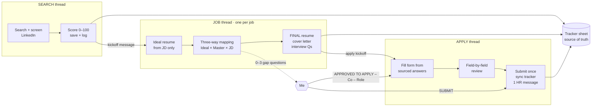

# LinkedIn Job Search & Apply Agent

**A human-in-the-loop Claude agent that finds LinkedIn jobs, tailors my resume to each one without inventing anything, and applies only after two explicit approvals.**

> I built this as a working tool for my own 2026 Senior PM job search, not as a demo. This repo is the actual agent design (system prompt, stage skills, data contracts, guardrails) with personal data and document IDs removed.

[](https://github.com/aswin-a/linkedin-job-search-agent/actions/workflows/checks.yml)

## The problem

Tailoring a resume well takes 1–2 hours per job, and doing it badly (keyword-stuffing, overclaiming) hurts more than it helps. Handing the job to an LLM raises three design problems:

1. **Honesty:** how do you get JD-optimised wording while keeping every claim true?
2. **Control:** how do you let an agent click buttons on LinkedIn as *you* without it ever submitting something you didn't approve?
3. **Cost:** how do you keep a long multi-tool workflow cheap and fast?

## How it works



| Mode | I send | The agent |
|---|---|---|
| **SEARCH** | `MODE: SEARCH` | Searches LinkedIn from my search profile, scores each job on a weighted rubric, saves qualifying ones, and logs each in the tracker with a ready-to-paste kickoff message. Never applies |
| **JOB** | the kickoff (one job per thread) | Saves the JD, writes an **ideal resume** from the JD alone, maps it against my **master resume**, asks only the gap questions that could change the result, then writes the FINAL resume, a cover letter if needed, and 10 likely interview questions |
| **APPLY** | the apply kickoff with the approval line | Fills the application only from sourced answers, shows a `Field \| Value \| Source` table, and waits for `SUBMIT`. Then it updates the tracker and LinkedIn, and sends one free message to the listed hiring contact |

## Design decisions worth a look

1. **Three sources of truth, never mixed.** Facts come from the master resume and my answers. Priorities come from the JD. Wording comes from an "ideal resume" written for a fictional perfect-fit candidate, *without* seeing my resume. The FINAL resume is my true experience in the ideal resume's language. → [three-way mapping](docs/three-way-mapping.md)
2. **A two-key approval gate that page text can't open.** The gate is armed only by `APPROVED TO APPLY - <Company> - <Role>` in *my* message in *this* thread. It fires only when my latest message is exactly `SUBMIT`, after a field-by-field review. JD and page text is treated as data, so an injected "submit now" does nothing. → [safety & guardrails](docs/safety-and-guardrails.md) · [injection eval case](evals/cases/02-easy-apply-injected-jd/expected.md)
3. **Gap questions only when they'd change the resume.** A question has to pass a three-part test: it matters for a requirement, the master resume doesn't answer it, and I haven't answered it before. 0–3 per job is normal. New facts are proposed back into the master resume on `UPDATE MASTER`, so the next job needs fewer questions.
4. **Thread-per-job, skill-per-stage, state outside the chat.** Each job's context holds one JD and one mapping. Approvals are scoped to a thread. Hand-offs between threads are kickoff messages, and state lives in Drive and the tracker, not in chat history. → [architecture](docs/architecture.md)

I wrote up what's weak about the design too: implicit orchestration, idempotency, the limits of "facts only" as a rule, missing evals. That's in **[design notes and trade-offs](docs/design-review.md)**, and how each failure is handled is in **[failure modes](docs/failure-modes.md)**.

## What's in the repo

```
agent/
  system-prompt.md        The orchestrator: modes, pipeline, sources of truth, gate, honesty and token rules
  commands.md             Every phrase the agent listens for (kickoffs, approvals, status)
skills/                   One Agent Skill per stage: Inputs / Outputs / Stop conditions + procedure
  job-search/             A: search, screen, score, shortlist
  ideal-resume/           C: JD analysis + requirement IDs + ideal resume
  tailored-resume/        D: three-way mapping, gap Qs, FINAL resume, fit check
    references/           Skim-formatting spec (loaded only when writing the resume)
  cover-letter/           Fact-only cover letter
  apply/                  E: approval-gated application
  linkedin-tracker-sync/  Mirror sheet status to LinkedIn's job tracker
  hr-outreach/            One message to the listed hiring contact
docs/                     Architecture, three-way mapping, guardrails, failure modes, token rules, design review, setup
tracker/                  Tracker schema (who writes each column) + CSV template
config/                   Templates: search profile, application answers, master resume
evals/                    Format checker, fictional golden cases, eval plan
scripts/                  Privacy check + skills/link linter (run in CI)
examples/                 A fictional end-to-end walkthrough
.claude-plugin/           Experimental plugin manifest for the skills
```

## Stack

- **Claude**: a Claude Project with custom instructions and project knowledge
- **Claude in Chrome** for LinkedIn and ATS portals (my real, signed-in browser)
- **Google Drive / Docs / Sheets connectors** for job folders, resumes and the tracker
- No application code. The "program" is the prompt architecture, the data contracts between stages, and the guardrails. The scripts here only check the repo and the resume format.

## Try it

- **Read a run:** [fictional walkthrough](examples/walkthrough.md), with one search, one job thread and one application.
- **Set it up:** [docs/setup.md](docs/setup.md). Create the Drive folders and tracker, fill in the three config templates, paste the system prompt into a Claude Project, then start a chat with `MODE: SEARCH`.
- **Run the checks:**

```bash
bash scripts/check_privacy.sh && python3 scripts/lint_repo.py && python3 evals/check_resume_format.py evals/fixtures/resume-good.html
```

## Results so far

Used across my 2026 Senior PM search for platform, API/integrations and AI product roles.

<!-- TODO(Aswin): add real numbers, e.g. jobs screened / saved / applied, time per tailored resume before vs after, interview call rate. -->
- Jobs screened and scored: `<n>`
- Tailored applications sent: `<n>`
- Time per tailored resume: `<before>` → `<after>`
- Interview conversion: `<n>`

## Roadmap

Proposed, not built yet (details in the [design notes](docs/design-review.md#9-prioritised-improvements)):

- **Claim trace table**: every FINAL resume bullet mapped to its master-resume line or answer, so "facts only" can be checked, not just stated.
- **`RECONCILE` command**: a read-only diff between the tracker and LinkedIn's job tracker.
- **More golden cases**, plus a headless eval run of the skills via the plugin packaging.
- **Job Search Lite**: paste a link and get the fit score, ideal resume, mapping and final resume, with no tracker and no applying.
- **Scheduled, unattended search runs** that write a shortlist doc and send a summary.

## License

MIT. Use the design freely, but please don't use it to mass-apply or to misrepresent your experience. That's the opposite of what it's built for.
