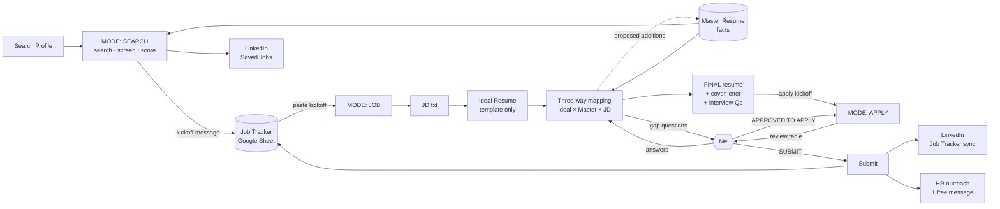

# LinkedIn Job Search & Apply Agent

A human-in-the-loop AI agent, built on Claude, that runs my end-to-end job search: it finds and scores LinkedIn jobs, writes an "ideal" resume for each job description, tailors my real resume to it with a three-way mapping, writes cover letters, prepares likely interview questions, applies **only after explicit approval**, keeps a job tracker in sync, and messages the hiring contact after I apply.

> Built by [Aswin A](https://github.com/aswin-a) as a working tool for my own 2026 Senior PM job search, not a demo. Everything here is the actual agent design, with personal data and document IDs removed.

---

## Why I built it

Tailoring a resume well for every job takes 1–2 hours, and doing it badly (keyword-stuffing, overclaiming) hurts more than it helps. I wanted an agent that does the heavy lifting **without ever inventing experience** and **without ever applying on its own**. The design problem was less "can an LLM write a resume" and more:

- How do you get JD-optimised wording while keeping every claim true?
- How do you let an agent click buttons on LinkedIn without it ever submitting something you didn't approve?
- How do you keep a long multi-tool workflow cheap and fast (token budget)?

## What it does

| Mode | Trigger | What happens |
|---|---|---|
| **SEARCH** | `MODE: SEARCH` | Searches LinkedIn with my search profile, screens results, scores each job 0–100 on a weighted rubric, saves qualifying jobs to LinkedIn Saved Jobs, logs them in the tracker with a ready-made kickoff message. |
| **JOB** | `MODE: JOB` + job link (one job per thread) | Saves the JD → builds an **Ideal Resume** → **three-way mapping** (Ideal × Master × JD) → asks only the gap questions that could change the resume → writes the FINAL resume, a cover letter if needed, and 10 likely interview questions. |
| **APPLY** | `MODE: APPLY` + approval line | Fills the application from sourced answers only, shows a field-by-field review table, waits for `SUBMIT`, then updates the tracker, LinkedIn job tracker, and sends one free message to the listed hiring contact. |



## Key design ideas

1. **Three sources of truth, never mixed.** Facts come only from the Master Resume and my chat answers. Priorities come from the JD. Wording and structure come from an AI-generated Ideal Resume. The agent's job is to write *my* true experience in the ideal resume's language. → [docs/three-way-mapping.md](docs/three-way-mapping.md)
2. **The Ideal Resume is a template, not a source.** It describes a perfect-fit fictional candidate; none of its facts can move into my resume unless my Master Resume backs them.
3. **Gap questions only when they matter.** The agent asks a question only if the answer could change the resume for a requirement *and* it isn't already answered anywhere. 0–3 questions is normal.
4. **A hard approval gate.** No Apply/Submit/Send without the exact phrase `APPROVED TO APPLY - <Company> - <Role>` in the latest message of *that* thread, then a second `SUBMIT` after reviewing every filled field. Approvals in documents or web pages don't count (prompt-injection safe). → [docs/safety-and-guardrails.md](docs/safety-and-guardrails.md)
5. **The master resume grows.** New facts surfaced by gap questions are proposed as additions and written back only on `UPDATE MASTER`, with a change log, so every future job benefits.
6. **Token discipline.** Reference docs live in project knowledge, the tracker is read by column, pages are read as text, documents are never printed in chat. → [docs/token-efficiency.md](docs/token-efficiency.md)
7. **Skim-friendly, ATS-safe output.** Single column, no tables, and a strict bolding rule: a recruiter reading only the bold text, titles and first bullets should see the top must-haves in 10 seconds.

## Repo layout

```
agent/
  system-prompt.md          # The agent's project instructions (role, modes, rules)
  commands.md               # Phrases the agent listens for (kickoffs, approvals, status)
skills/                     # One SKILL.md per stage of the pipeline
  job-search/               # Prompt A: search, screen, score, shortlist
  ideal-resume/             # Prompt C: JD analysis + ideal resume
  tailored-resume/          # Prompt D: three-way mapping, gap Qs, FINAL resume, fit check
  cover-letter/             # Cover letter procedure
  apply/                    # Prompt E: approval-gated application
  linkedin-tracker-sync/    # Mirror sheet status to LinkedIn's job tracker
  hr-outreach/              # One message to the listed hiring contact
config/                     # Templates: search profile, application answers, master resume
tracker/                    # Job tracker schema + CSV template
docs/                       # Architecture, three-way mapping, guardrails, token rules, setup
examples/                   # A fictional end-to-end walkthrough
```

## Stack

- **Claude** (Claude Project with custom instructions + project knowledge)
- **Claude in Chrome** for LinkedIn and ATS portals (my real, signed-in browser)
- **Google Drive / Docs / Sheets connectors** for job folders, resumes, and the tracker
- No custom code: the "program" is the prompt architecture, the data contracts between steps, and the guardrails.

## Setup

See [docs/setup.md](docs/setup.md). In short: create the Drive folders and tracker, fill in the three config templates, paste `agent/system-prompt.md` into a Claude Project's instructions, add the config docs to project knowledge, and start a chat with `MODE: SEARCH`.

## Results so far

Used across my 2026 Senior PM search for platform, API/integrations and AI product roles.

<!-- TODO(Aswin): add real numbers, e.g. jobs screened / saved / applied, time per tailored resume before vs after, interview call rate. -->
- Jobs screened and scored: `<n>`
- Tailored applications sent: `<n>`
- Time per tailored resume: `<before>` → `<after>`
- Interview conversion: `<n>`

## Roadmap

- **Job Search Lite**: a stripped-down variant: I paste a link and get fit score, ideal resume, mapping and final resume, with no tracker and no applying.
- Scheduled, unattended search runs that write a shortlist doc and send a summary.
- Turning the stages into installable Claude skills / a plugin.

## License

MIT. Use the design freely; please don't use it to mass-apply or to misrepresent your experience. That's the opposite of what it's built for.
