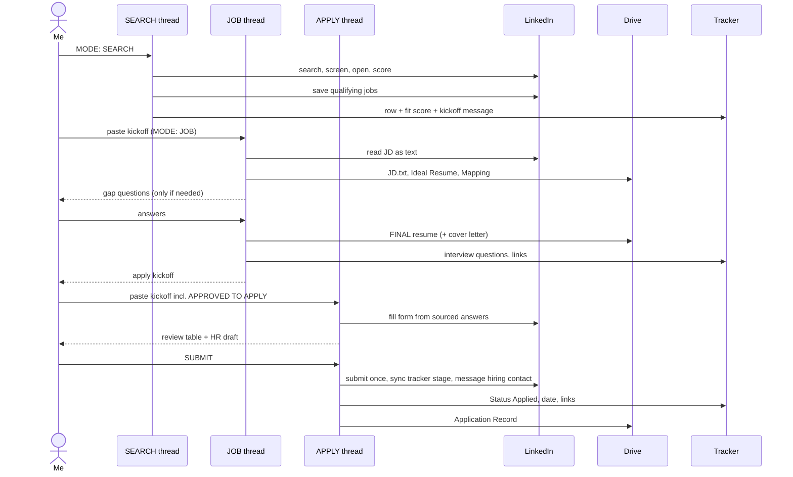

# Architecture

## Components

| Layer | What | Role |
|---|---|---|
| Orchestrator | Claude Project + [system prompt](../agent/system-prompt.md) | Detects the thread mode, runs the right skill, enforces rules |
| Procedures | [skills/](../skills) | One stage each, with explicit inputs, outputs and stop points |
| Knowledge | Master Resume, Search Profile, Application Answers | Loaded once from Project Knowledge, not fetched per turn |
| Browser | Claude in Chrome (user's signed-in Chrome) | LinkedIn search, job pages, Easy Apply, ATS forms, tracker sync, messages |
| Storage | Google Drive / Docs | One folder per job: JD, ideal resume, mapping, FINAL resume, cover letter, application record |
| State | Google Sheet "Jobs" | Source of truth for every job's status and links |
| Human | Me | Answers gap questions, approves, uploads PDFs, signs in, solves CAPTCHAs |

## Thread-per-job design

Each job gets its own chat thread. This keeps context small (one JD, one mapping), makes approvals unambiguous (`APPROVED TO APPLY` only counts in *this* thread for *this* job), and gives a clean audit trail per application.



## Job folder layout (Drive)

```
Job Search 2026/
  00_Master/        Master Resume, Change Log
  01_Tracker/       Job Tracker sheet, shortlist docs
  02_Jobs/
    <Company> - <Role> - <date>/
      JD.txt
      <Company> - <Role> - Ideal Resume - <date>
      <Company> - <Role> - Mapping and Gap Questions - <date>
      <Company> - <Role> - Customized Resume - FINAL - <date>
      <Company> - <Role> - Cover Letter - FINAL - <date>     (if required)
      <Company> - <Role> - Application Record - <date>
```

## Data contracts between stages

- **Requirement IDs** (`M1…`, `N1…`) are created in the ideal-resume step and reused by mapping, bolding, the skim test and interview questions. They're the thread that ties every output back to the JD.
- **Kickoff messages** are generated by one stage and consumed by the next, so moving between threads is copy-paste with no re-explaining.
- **The sheet is the source of truth for status**; LinkedIn's tracker is a mirror.
