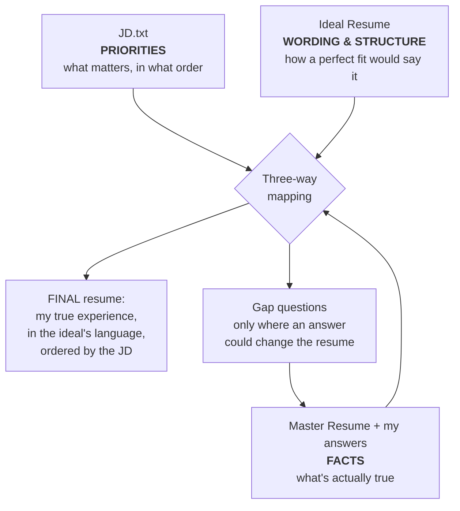

# The three-way mapping

The core idea of the agent. Most AI resume tailoring either rewrites your resume with the JD's keywords (and drifts into claims you can't back up) or barely changes it. This agent separates the problem into three sources with one job each.

## How it works

1. **Ideal Resume first, from the JD alone.** The agent writes a resume for a fictional perfect-fit candidate, every bullet tagged with the requirement IDs it covers. It never sees my resume at this point, so it's free to find the best possible language.
2. **Map every ideal bullet against my facts.** For each one: JD relevance, and whether my Master Resume *fully*, *partially* or *doesn't* support it, with the evidence. A second table catches JD requirements the ideal resume missed.
3. **Ask only what could change the outcome.** A question is asked only if it's for a meaningful requirement, the master doesn't already answer it, and I haven't answered it before. Questions probe adjacent evidence (side projects, freelance, brief use) rather than asking "do you have X?".
4. **Write the FINAL resume.** Ideal resume's structure and phrasing, filled with verified facts. Unsupported points are removed, partial matches worded honestly, and anything that's a stretch gets flagged and turned into an interview question.
5. **Grow the master.** New facts from my answers are proposed as master-resume additions and applied on `UPDATE MASTER`, so the next job needs fewer questions.

## Why it works

- The ideal resume gives **JD-native language and structure** without contaminating facts.
- The master resume being the **only fact source** makes honesty enforceable: every claim must trace to a line or an answer.
- Requirement IDs make coverage **measurable** (how many must-haves are Fully / Partially / Not supported) instead of a vibe.
